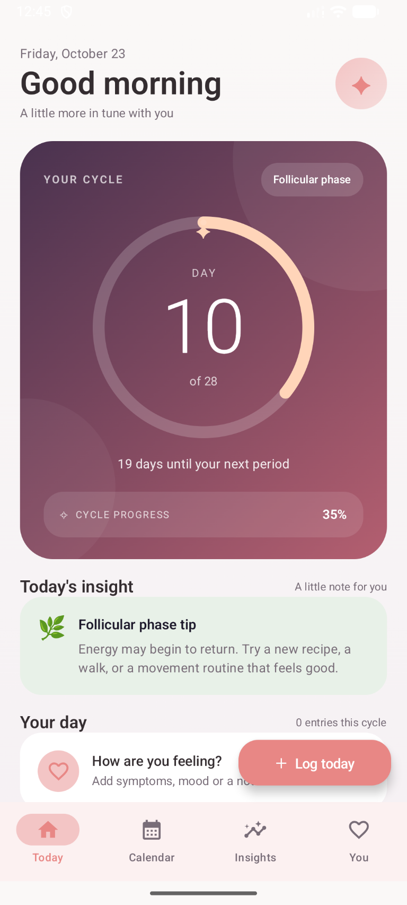
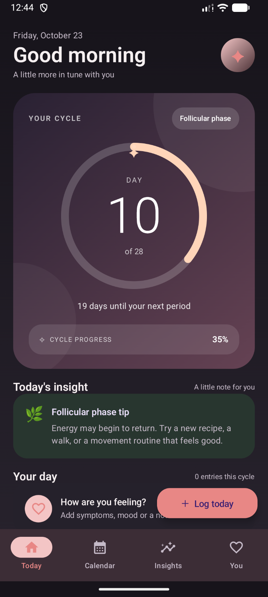
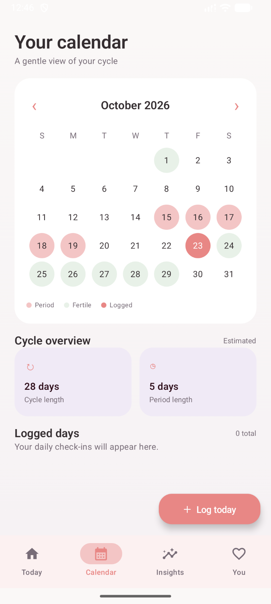
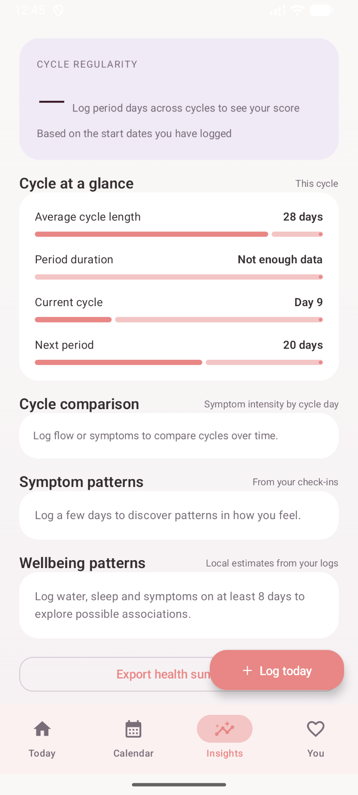
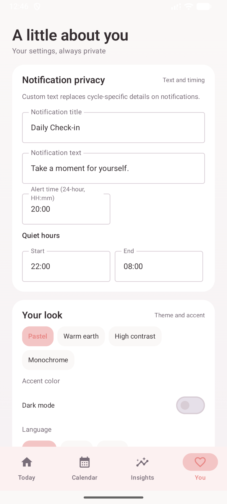

# Luna

**A private, thoughtful space to understand your cycle and daily wellbeing.**

Luna is an Android cycle-tracking app for recording periods, symptoms, mood, and everyday wellbeing. Use the calendar and insights to review your own history, with estimates based on the information you choose to log.

> Cycle dates and phase information are estimates, not medical advice or contraception. Cycles vary, and predictions may be less useful when there is limited or irregular history.

## Screenshots

<p align="center">
  
  
  
  
  
</p>

## What you can do

- **Check in each day:** record period flow, symptoms, mood, notes, water, sleep, activity, and other available details.
- **Review your cycle:** see cycle and period summaries, logged days, calendar history, and estimated cycle phases.
- **Explore insights:** compare symptoms across cycle days and review patterns from your own check-ins. Insights appear as enough information is available.
- **Set reminders:** choose reminder text and timing, and configure quiet hours.
- **Choose your experience:** use light or dark mode, select an appearance, and choose English, French, or Arabic.
- **Keep a quick-log widget:** add a check-in from your Android home screen.
- **Manage your data:** export a health summary, use an encrypted passphrase-protected backup, or sync with the device calendar where enabled.

## Privacy

Luna is designed for local use without an account. Cycle logs are stored in an encrypted SQLCipher database, with the database key protected using Android Keystore. The app does not declare the Android internet permission.

Encrypted backups are separate files protected by a passphrase you choose. Keep that passphrase safe: you need it to restore the backup. Exported summaries and calendar entries may contain sensitive information, so choose where you save or share them carefully.

## Get started

### Requirements

- Android Studio with Android SDK Platform 35
- JDK 17
- Android device or emulator running Android 8.0 (API 26) or later

Clone the repository and open it in Android Studio, then allow Gradle to sync. You can also build from PowerShell in the project directory:

```powershell
.\gradlew.bat assembleDebug
```

The debug APK is created under `app/build/outputs/apk/debug/`.

### Build a release APK

```powershell
.\gradlew.bat assembleRelease
```

The release APK is created under `app/build/outputs/apk/release/`. Release signing is not configured, so the generated APK is **unsigned** and needs to be signed before normal installation or distribution.

### Run tests

```powershell
.\gradlew.bat test
```

## Permissions

Depending on the features you use, Android may ask Luna for notification access, calendar access, or biometric authentication. You can manage app permissions in Android Settings. Calendar access is needed only for calendar integration; notifications are used for reminders.

## Built with

- Kotlin and Jetpack Compose
- AndroidX Room and SQLCipher
- Android Keystore
- Gradle

## Screenshots and releases

Browse the [source code](https://github.com/ilyxfz/Luna) or visit [GitHub Releases](https://github.com/ilyxfz/Luna/releases) for published builds and release notes.
